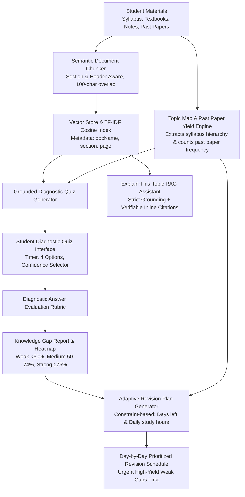

# 🧭 GapFinder AI
### Academic Knowledge Gap Diagnostic & Adaptive Revision Engine

> **Tagline:** *Find what you don’t know before the exam does.*

GapFinder AI is a diagnostic learning platform built for hackathon and placement evaluation. Unlike generic "chat with your PDF" tools that passively wait for a student's question, **GapFinder AI actively diagnoses hidden blind spots** from a student's syllabus, textbook excerpts, lecture notes, and past examination papers — constructing an adaptive, prioritized revision plan.

---

## 🏆 Why GapFinder AI Stands Out (Winning Innovations)

1. **Diagnosis Before Questions:** Traditional AI tools require students to ask questions, but students cannot ask about gaps they don't know they have. GapFinder AI proactively detects gaps via grounded diagnostic assessments.
2. **High-Yield Past Paper Weightage Analyzer:** Scans 3 years of past examination papers, counts question frequency and mark allocation, and tags topics as *High Yield*, *Medium Yield*, or *Low Yield*. Weak topics that appear frequently on past exams are pushed to the top of the revision queue!
3. **Strict RAG Separation (Zero Hallucinations):** Retrieval and generation are strictly decoupled. Questions and explanations must cite exact textbook chapters and sections.
4. **Confidence-Calibrated Assessment:** Students tag answers as *100% Confident*, *Fairly Sure*, or *Educated Guess*. The system flags lucky guesses to prevent artificial inflation of mastery scores.
5. **Gamified Revision Habit for Students & Kids:** Features a **Revision Streak Counter** (🔥), **XP Levels**, unlockable **Mastery Badges**, and particle celebrations on milestones.
6. **Zero-Setup Evaluator Instant Access:** Pre-loaded with a full University Computer Science course (*CS301: Operating Systems & Concurrency*) including syllabus, textbook chapters, lecture notes, and 3 past question papers pre-indexed for instant testing.

---

## 🏗️ System Architecture



---

## 🧠 AI Pipeline: Retrieval vs. Generation Separation

GapFinder AI enforces a strict mathematical and architectural separation between retrieval and generation:

| Phase | Component | Responsibility |
|---|---|---|
| **1. Ingestion & Chunking** | `src/lib/rag/chunker.ts` | Splits text into semantic paragraphs preserving chapter headings, section titles, and page estimates. |
| **2. Vector Indexing** | `src/lib/rag/vector-store.ts` | Builds normalized TF-IDF and n-gram vectors with cosine similarity scoring. |
| **3. Retrieval** | `SimpleVectorStore.search(query, topK=4)` | Retrieves top-k matching chunks with similarity thresholds, section boosts, and snippet extraction. |
| **4. Grounded Generation** | Google Gemini 1.5 Flash / `GeminiRAGService` | Model receives **only** retrieved chunks in system context. Instructed strictly never to invent outside facts and to cite bracketed references `[Source X]`. |
| **5. Resilient Local Fallback** | `src/lib/rag/gemini.ts` | If no API key is supplied or during offline review, a high-fidelity local semantic template engine delivers verifiable grounded answers without network crashes. |

---

## 🚀 Live Demo & Evaluator Credentials

Evaluators and judges can test the full platform immediately without entering an API key or uploading files:

- **Role:** Judge / Evaluator Mode
- **Name:** Prof. Alex Mercer
- **Demo Email:** `judge@gapfinder.ai`
- **Demo Password:** `demo_judge_2026`
- **Pre-Loaded Course:** CS301 Operating Systems & Concurrency
  - 4 Pre-indexed documents (Syllabus, Textbook Chapters 4 & 7, Lecture Notes, Past Papers 2023-2025)
  - 5 Mapped Topics with Pre-diagnosed Gaps (e.g. Banker's Algorithm - Weak, Belady's Anomaly - Weak)
  - Active 4-Day Revision Streak & Level 3 XP

---

## 🛠️ Tech Stack

- **Framework:** [Next.js](https://nextjs.org/) (App Router, Turbopack, React 19)
- **Language:** TypeScript 5
- **Styling:** Tailwind CSS 4 with custom dark mode academic design tokens
- **AI & RAG:** Google Generative AI SDK (`@google/generative-ai`), Gemini 1.5 Flash, TF-IDF Cosine Similarity Vector Index
- **Gamification:** `canvas-confetti` particle celebrations, revision streaks, XP level progression
- **Icons:** `lucide-react`

---

## 💻 Local Setup Instructions

### 1. Clone the repository
```bash
git clone <repository_url>
cd hack_on
```

### 2. Install dependencies
```bash
npm install
```

### 3. Run development server
```bash
npm run dev
```

Open [http://localhost:3000](http://localhost:3000) in your browser.

### 4. (Optional) Configure Gemini API Key
- Click the **API Key** button in the navigation bar.
- Paste your free Google Gemini API key from [Google AI Studio](https://aistudio.google.com/app/apikey).
- Click **Test Connection** & **Save Key**. The application works seamlessly with or without an API key!

---

## 📋 Features Checklist (Company Requirements)

- [x] **1. Material Upload:** Upload syllabus, textbook chapters, notes, and past papers (text, markdown, PDF) with semantic chunk inspection.
- [x] **2. Topic Map:** Hierarchical syllabus structure with subtopics and past examination question frequency.
- [x] **3. Diagnostic Quiz:** Assessment questions generated directly from course material with citations and confidence calibration.
- [x] **4. Gap Report:** Weak (<50%), Medium (50-74%), and Strong (≥75%) classification with detailed diagnostic reasoning.
- [x] **5. Knowledge Gap Heatmap:** Interactive visual matrix showing topic mastery and high-yield examination flags.
- [x] **6. Adaptive Revision Plan:** Day-by-day study schedule prioritizing High-Yield Weak topics first, factoring in days remaining and daily hours.
- [x] **7. Explain-This-Topic RAG Tutor:** Conversational AI assistant strictly answering from uploaded material with expandable citations.
- [x] **8. Revision Streak & Gamification:** Daily streak tracking, XP points, and milestone badges to keep students and kids motivated.
- [x] **9. Demo Evaluator Authentication:** Instant 1-click login for judges with preloaded sample materials.

---

## 🔮 Limitations & Future Enhancements

- **PDF OCR:** Currently parses textual PDFs and documents; future expansion includes Tesseract/Vision OCR for handwritten lecture notes.
- **Spaced-Repetition Reminders:** Web Push notifications for daily streak reminders and flashcard intervals.
- **Teacher Classroom Analytics:** Aggregated multi-student dashboard enabling instructors to view class-wide topic weakness heatmaps.
- **LMS Integration:** Export revision schedules to Google Calendar, Canvas, and Moodle.
